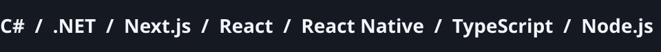
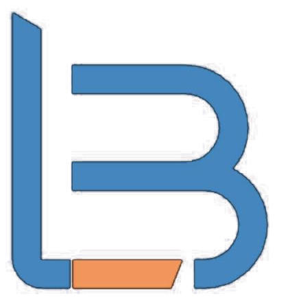
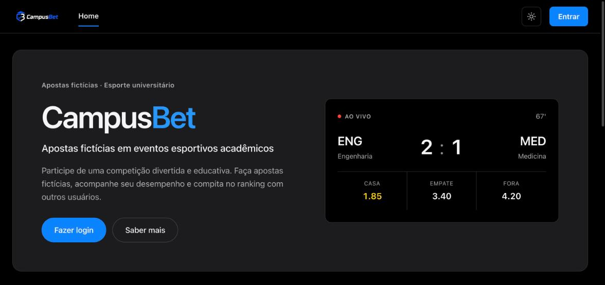
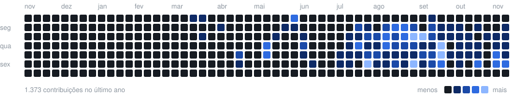

# Desenvolvedor Full Stack

Construo portais web, APIs e aplicativos, do banco de dados à interface.

[LinkedIn](https://www.linkedin.com/in/joaopedrosilvadealmeida00) | [joaojfpedroas@gmail.com](mailto:joaojfpedroas@gmail.com)

| Área | Tecnologias |
| --- | --- |
| Front-end | React, Next.js, TypeScript, JavaScript, Tailwind CSS |
| Mobile | React Native, Expo, Kotlin, Swift |
| Back-end | C#, .NET, ASP.NET, Node.js, Python, Java |
| Banco de dados | PostgreSQL, SQL Server, Supabase, Firebase |
| DevOps e cloud | Git, GitHub Actions, CI/CD, Docker, AWS, Azure |

## Trabalho

 Desenvolvedor de Software na LBeB Consultores Associados, desde junho de 2025.

###  LogLB

Minha principal frente na LBeB. Acompanha a carga rodoviária da nota fiscal até a entrega confirmada com foto do canhoto.

Next.js, React Native, Node.js e PostgreSQL. Site: [loglb.com.br](https://loglb.com.br)

## Projetos

### CampusBet

Apostas esportivas acadêmicas com saldo fictício, histórico, ranking e conquistas.

React, Vite e Context API. [Abrir o site](https://campusbet-rust.vercel.app/) | [Repositório](https://github.com/joaooopedro/campusbet)

### Outros

- **[UniRide](https://github.com/joaooopedro/uniride-mobile)**: carona entre alunos da universidade, com pedido de vaga, chat e avaliação depois da viagem. React Native e Firebase.
- **[Painel de Vendas](https://github.com/joaooopedro/painel-vendas-mvc)**: cadastro de departamentos, vendedores e vendas, com login e relatórios por período. ASP.NET MVC e SQL Server.
- **Projeto Abolição**: site do Centro Cultural de Capoeira Abolição, com matrícula on-line. Liderei a equipe. React, TypeScript e Tailwind.

## Formação

 **UniAcademia**: Engenharia de Software. 5º período, conclusão em dezembro de 2028.

## Atividade

